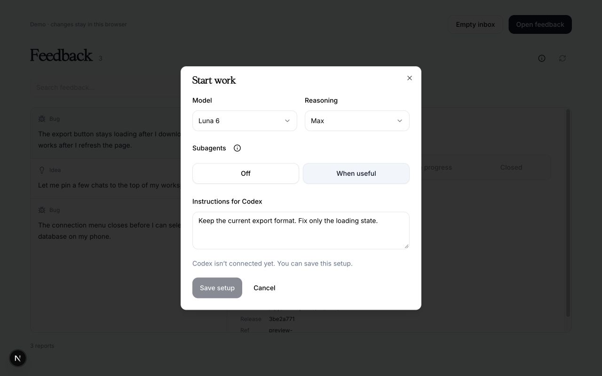
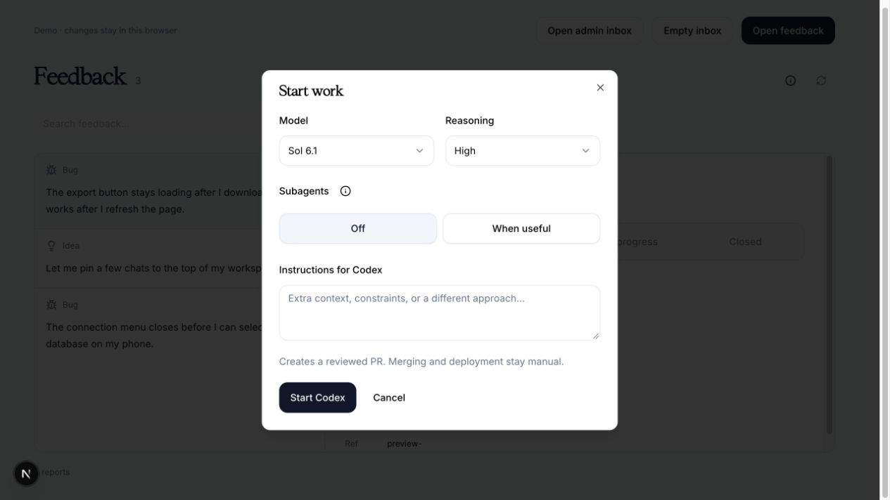
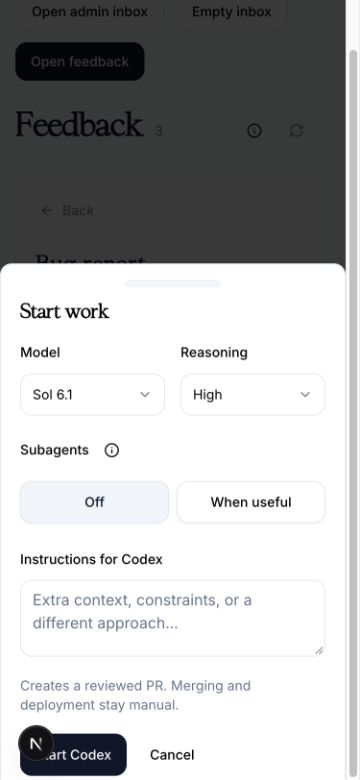

# Review UI and manual execution settings acceptance

Source candidate 0.3.0. No npm or hosted-registry release is claimed.

The optional shadcn source block supplies a responsive inbox, direct status/context actions, one model/reasoning/subagent/instruction setup overlay, private history and run receipts with Stop/chat/PR actions. Authentication, storage and fenced execution remain app-owned. Default execution is Sol 6.1 / High / subagents Off. Datadon's adapter supplies the tested private backend; the block itself does not grant execution access.

108 kit tests, types and build passed. The generated shadcn item resolved successfully with `shadcn add <item.json> --dry-run`, with no files overwritten. The source derives from the Datadon components whose 62 focused tests, scoped lint, TypeScript and production build passed. Two pre-existing application filesystem tracing warnings remain. Registry peer primitives must be reviewed against the receiving app's installed shadcn version before installation.

The no-model sandbox proof passed on macOS using CLI 0.163.0, including real private env/auth/Keychain denials, read-only dependencies, review write denial and sandboxed validation. A real Sol 6.1/High delegated run completed; the helper inherited those settings and could not open a synthetic file outside its allowed checkout (`EPERM`). Budget-abort tests include helper usage. The source cap is 500,000 aggregate tokens; applications choose explicit run/daily reservations and should expect a possible one-response overshoot.

A separate real Sol 6.1/High synthetic bug journey completed implementation, focused/shared checks, independent read-only review and parent publication to a local synthetic review branch. Candidate commit `5054258cf8add59ada13184a970b3cf641f20143`. This is not a Datadon production fix or GitHub PR receipt. Consumer applications still need their own authenticated acceptance and web deployment; no auth session was synthesized for these checks.

Actual synthetic preview captures at the existing feedback lane (base 3be2a77 plus uncommitted app UI). Before: saved preferences on 16 October. After: Start Codex action on 17 October, desktop and 375×812 mobile. The unauthenticated demo explicitly refuses a real launch; a signed-in admin route is required. These captures do not establish production p75 field performance.

Before:

After:

Signed-in Datadon acceptance subsequently passed through the actual local application and database. A manually approved documentation-only report used Sol 6.1 / High / subagents auto, a real helper with inherited settings, an isolated checkout of current main, shared TypeScript/lint validation and independent read-only review. It produced [consumer PR #65](https://github.com/techlocal-accounts/chat-to-your-db/pull/65), commit `bfbeaf33a9eeaafa06660e6bc8c1ed96ce272de8`, and a real PR-ready inbox receipt. The synthetic report was then closed through the UI; nothing was merged or deployed.

This journey exposed the former 200,000-token ceiling: the first attempt stopped truthfully during review at 201,286 tokens. A failing budget regression preceded the source correction. The repeat completed at 317,425 tokens within a 500,000 aggregate budget, including cached context, helpers and independent review. The consumer's rollback-only database tests also verified releasing unused terminal reservations while keeping an explicit rolling daily allowance.
